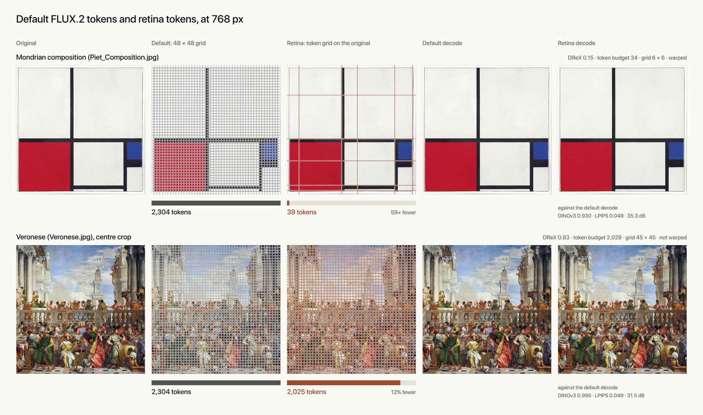
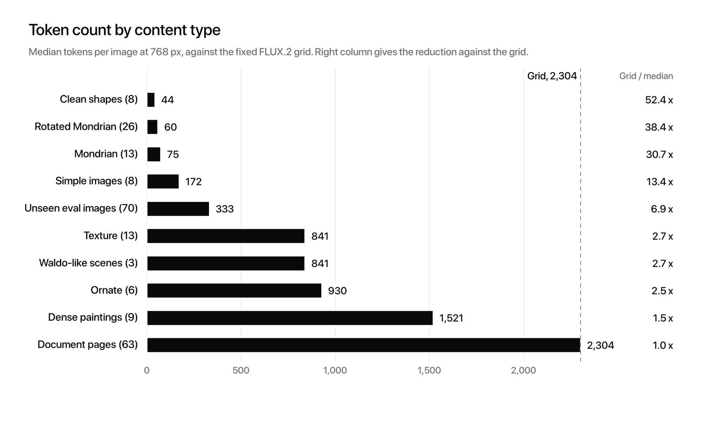
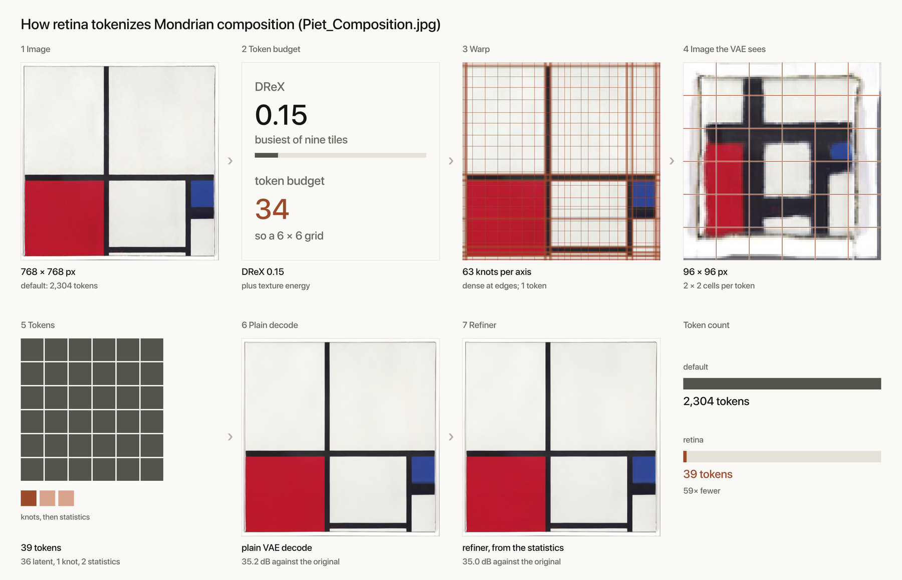
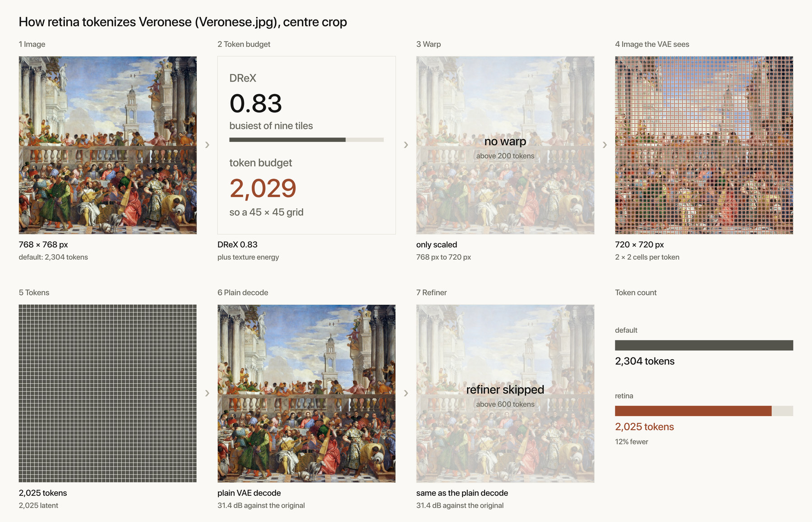
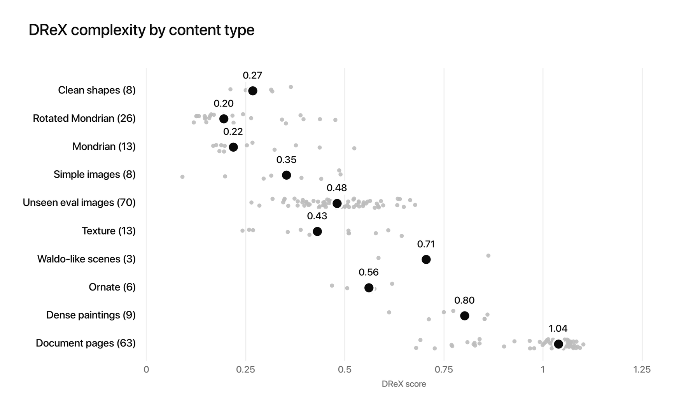
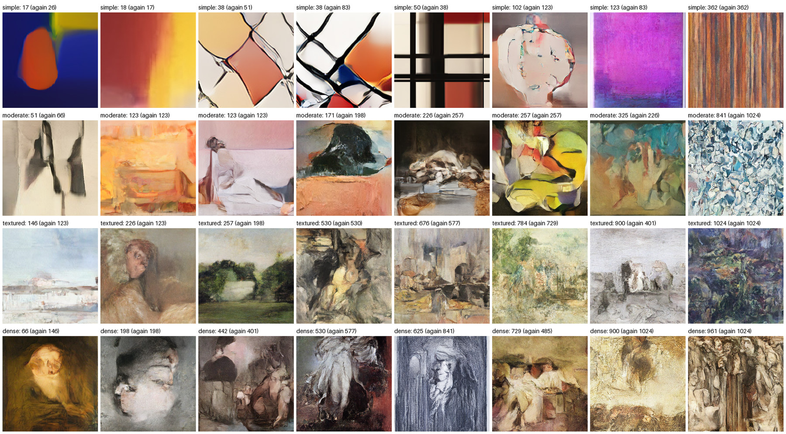
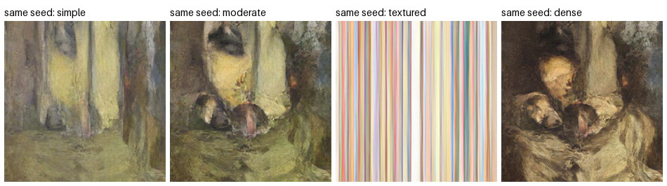

# retina

An image tokenizer whose token count follows the image's content. A Mondrian costs about 70 tokens, a Where's Waldo page costs 1,764, and no image costs more than the plain VAE grid of 2,304 at 768 px. Tokens are ordinary FLUX.2 latents, 128 floats each, in one sequence an autoregressive model can read. A small MAR model trained on these tokens is included.



## Results at 768 px

| Group | Images | Median tokens | Grid / median |
|---|---|---|---|
| Clean synthetic shapes | 8 | 44 | 52x |
| Rotated Mondrian | 26 | 60 | 38x |
| Mondrian | 13 | 75 | 31x |
| Simple images | 8 | 172 | 13x |
| Unseen eval images | 70 | 333 | 6.9x |
| Texture | 13 | 841 | 2.7x |
| Waldo-like scenes | 3 | 841 | 2.7x |
| Ornate | 6 | 930 | 2.5x |
| Dense paintings | 9 | 1,521 | 1.5x |
| Document pages | 63 | 2,304 | 1x |

The median Mondrian costs 75 tokens and the Waldo book page 1,764: a **23.5x** gap (95% bootstrap interval 19.2-29.4x over 13 Mondrians), and 10 of 13 Mondrians are more than 16x cheaper than the page. These counts include the warp and statistics tokens as stored; packed into 128-float tokens the median Mondrian is 67. Encoding takes .23 s and decoding .09 s on one L4.



How close is it to the full grid? Our decode against the plain FLUX.2 decode with all 2,304 tokens, median and worse 10%:

| Group | DINOv3 patch similarity | LPIPS | PSNR dB |
|---|---|---|---|
| Mondrian | .930 / .909 | .156 / .226 | 33.7 / 26.2 |
| Unseen eval | .965 / .943 | .140 / .215 | 26.1 / 22.4 |
| Dense paintings | .993 / .988 | .063 / .143 | 31.0 / 28.3 |
| All 259 images | .972 / .912 | .102 / .223 | 30.4 / 23.4 |

Busy images keep most of their tokens and are close to the grid by every measure. Cheap images keep lines and colour and lose canvas weave and cracks, which LPIPS sees. The full grid itself is near the original (LPIPS .007), so almost all of the gap is the tokens we drop.

## How it works



1. **Budget.** [DReX](https://github.com/jskaza/DReX), a learned complexity score, raised to the busiest of nine 256 px tiles, plus texture energy, gives a token count through a fitted curve. DReX's last layers are [tuned for text](https://huggingface.co/tensorkelechi/DReX-text-tuned), so documents keep their tokens.
2. **Resize.** The image is resized so the FLUX.2 grid has that many tokens. Four VAE cells make one 128-float token.
3. **Warp.** Below 200 tokens, the image is warped first so resolution goes to edges; the knots cost one token.
4. **Floor.** If the decode falls under 22 dB PSNR, the budget grows until it clears it.
5. **Refiner.** At 600 tokens or fewer, 27 statistics per 256 px tile (2 tokens at 768) feed a small refiner after the VAE decoder, which puts back edges and some texture.
6. **Pack.** Knots, statistics and latents become one sequence with a layout record that says which token is which.

A busy image goes through the same steps and simply keeps most of its grid:





## Install

Needs a CUDA GPU (an L4 is enough) and [uv](https://docs.astral.sh/uv/).

```bash
git clone https://github.com/kelechi-c/retina && cd retina
uv sync
```

The evaluation script uses DINOv3, which is gated: request access on [its model page](https://huggingface.co/facebook/dinov3-vitb16-pretrain-lvd1689m), then log in.

```bash
uv run hf auth login
```

Weights download on first use: the FLUX.2-dev VAE from Black Forest Labs, DReX from its GitHub release, the tuned DReX head, and the refiner and MAR weights from [tensorkelechi/retina-tokenizer](https://huggingface.co/tensorkelechi/retina-tokenizer). FLUX.2-dev and DINOv3 come with their own licences.

## Use

```python
from retina import Tokenizer, load_img, save_png

tok = Tokenizer()                          # the defaults above
x = load_img("examples/simple/mondrian_piet.jpg", 768).cuda()
t = tok.encode(x)
seq = Tokenizer.pack(t)["seq"]             # [N, 128]; N = 39 here, 2,304 for the plain grid
save_png(tok.decode(t), "decoded.png")
```

The same as a script:

```bash
uv run python examples/quickstart.py examples/simple/mondrian_piet.jpg decoded.png
```

The main options of `Tokenizer(...)`: `learned=None` turns off the refiner, `drext=None` uses the original DReX, `gap` widens (above 1) or narrows the spread between simple and busy images, `floor` sets the PSNR floor (0 turns it off), `tile=0` scores the whole image only, `warp_max=0` turns off the warp, and `vae` picks `flux2` (default), `flux` or `qwen`. Images are centre-cropped to a square; 768 is the size everything was fit and measured at, and other multiples of 256 work.

## Evaluate

Tokens per image and closeness to the full grid, for a folder of images grouped by subfolder:

```bash
uv run python eval/evaluate.py examples eval_out
```

It prints the median and p90 tokens per group and DINOv3, LPIPS and PSNR against the grid decode, and writes `eval_out/eval.json`. `--no-metrics` skips the comparison, `--save` keeps both decodes.

## MAR: generating retina tokens

`mar/` is a small masked autoregressive model, 57M parameters, trained on these tokens at 512 px. It first draws a layout, which fixes how many tokens the picture gets, then knots and statistics, then the latents in random order, each drawn by a flow-matching head. It is conditioned on one of four content labels: simple, moderate, textured and dense.



Each caption gives the label, the tokens the model wrote, and in brackets the tokens the tokenizer gives when it re-encodes the picture. Over 64 samples those two agree with a rank correlation of .96, and the median length rises from 44 tokens for simple to 625 for dense. The pictures are painterly, without clean objects: about what 57M parameters and 47,000 training images allow. One seed under each label keeps the composition and changes the style:



Sample from the released weights:

```bash
uv run python -m mar.sample mar_out --per 4
```

Train your own. `mar.encode` tokenizes WikiArt, DTD textures and procedural flat images into the four labels; `mar.train` trains and ends by sampling. A toy run takes a few minutes on an L4:

```bash
uv run python -m mar.encode mar_toy/enc --caps 0/procedural=32,2/dtd=32,1/wikiart=32,3/wikiart=32 --p 1,1,1,1
uv run python -m mar.train mar_toy/train mar_toy/enc/tokens.pt --steps 300 --budget 4000 --warmup 50 --every 100 --samples 1
uv run python -m mar.sample mar_toy/samples --ckpt mar_toy/train/mar.pt --per 1 --live
```

The released model used `mar.encode` with its default caps (12,000 images, 52 minutes on an A100), 30,000 steps of `mar.train` with `--budget 12000`, then another 34,795 images added with `--load` and `--more`, trained `--until 100000`: 9.8 steps a second on an A100, about 2.8 hours of training. The curated part of that data sits on a private repo; without `--manifest` the encoder skips it.

## Tests

```bash
uv run python tests/test_end_to_end.py
uv run python tests/test_flags.py
bash tests/test_mar.sh
```

The first checks the defaults, an exact pack round trip, that the Mondrians cost under an eighth of the busy paintings, and one MAR sample per label. The second runs each main option on a simple and a busy image. The third is the toy MAR run above plus sampling from the released weights.

## Compute

| | Compute |
|---|---|
| Tokenizer: budget fit, DReX text tune, S1 refiner | about 7 Colab units on an L4 and $1 of Modal A10G |
| Released MAR: encoding and 100,000 steps | about 30 Colab units (4.4 A100 hours) and $3.50 of Modal A10G |
| All search since the elastic grid, those included | about 45 Colab units and $23 of Modal |

The breakdown, and the earlier stages, are in [docs/ARTICLE.md](docs/ARTICLE.md#compute).

## Running on Modal

```bash
uv sync --extra modal
uv run modal run tools/modal_run.py --cmd "python tests/test_end_to_end.py OUT" --run test --gpu L4
uv run modal volume get retina-runs test ./test_out
```

Any repo command works in `--cmd`; `OUT` becomes the run's folder on the `retina-runs` volume. It needs a Modal secret named `huggingface` holding `HF_TOKEN`.

## Layout

```
retina/      the tokenizer package: tokenizer.py, warp.py, drex.py, refiner.py, vae.py
mar/         the MAR model, data, encoding, training and sampling
eval/        evaluate.py
examples/    quickstart.py and four public-domain paintings
tests/       end to end, options, MAR
tools/       modal_run.py
docs/        ARTICLE.md, the write-up
```
